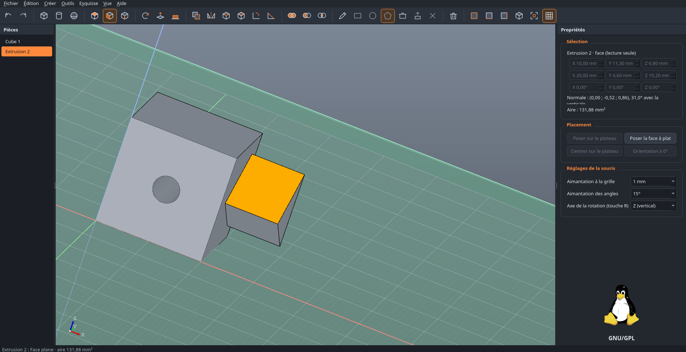

# FreeTable3D

Logiciel libre de CAO simple, pensé pour concevoir des pièces à imprimer en 3D. Écrit en C++ avec
OpenCascade et Qt 6, pour Linux et Windows. Interface en français et en anglais.

Dépôt : https://github.com/morvux/freetable3d

## Fonctions

- Formes de base (cube, cylindre, sphère) et **esquisses** 2D (rectangle, cercle, polygone) avec cotes
  modifiables par double-clic, saisie des dimensions au clavier et précision au dixième de millimètre
- **Extrusion** : nouvelle pièce, ajout de matière ou creusement dans une pièce existante
- Déplacement, rotation, redimensionnement par valeurs, étirement d'une face, poser une face à plat
- Perçage, congés, chanfreins, évidement (coque), symétrie, duplication et réseaux
- Union, soustraction et intersection de pièces
- Copier / coller, annuler / rétablir, sauvegarde automatique avec récupération après un plantage
- **Mesure de distance** entre deux points (sommets, milieux d'arêtes, centres de faces, de cercles ou
  de pièces), qui suit la pièce quand on la déplace ou l'étire
- Plateau d'impression, grille graduée en millimètres et **contrôle avant impression** (validité,
  taille du plateau, parois trop fines repérées en rouge)
- Projets `.ft3d`, import **STEP**, export **STL** (impression) et **STEP** (autres logiciels de CAO)

## Installation

Téléchargez le fichier correspondant à votre système depuis la page des
[versions](https://github.com/morvux/freetable3d/releases).

### Linux : AppImage

Un seul fichier, sans installation, qui fonctionne sur la plupart des distributions récentes :

    chmod +x FreeTable3D-0.1.5-x86_64.AppImage
    ./FreeTable3D-0.1.5-x86_64.AppImage

Si l'AppImage ne se lance pas, il manque peut-être la bibliothèque FUSE :

    sudo apt install libfuse2        # sur les versions récentes : libfuse2t64

Vous pouvez aussi la lancer sans FUSE : `./FreeTable3D-0.1.5-x86_64.AppImage --appimage-extract-and-run`.

### Windows 11 : installateur

Téléchargez `FreeTable3D-0.1.5-windows-setup.exe` et lancez-le. Windows peut afficher un
avertissement (SmartScreen), car l'installateur n'est pas signé : cliquez sur « Informations
complémentaires », puis « Exécuter quand même ».

## Compilation (Debian / MX Linux)

Dépendances :

    sudo apt install build-essential cmake qt6-base-dev libocct-foundation-dev \
        libocct-modeling-data-dev libocct-modeling-algorithms-dev \
        libocct-visualization-dev libocct-data-exchange-dev libgl1-mesa-dev

Compilation et lancement :

    cmake -B build && cmake --build build -j
    ./build/freetable3d

Pour construire l'AppImage : `bash packaging/appimage/construire.sh`
(à lancer sur la distribution la plus ancienne que vous visez, pour une compatibilité maximale).

## Contribuer

Les signalements de problèmes et les suggestions sont les bienvenus dans les
[Issues](https://github.com/morvux/freetable3d/issues). Pour un problème d'affichage, indiquez votre
système, votre bureau et votre carte graphique.

## Licence

Copyright (C) 2026 KREUDER olivier, FreeTable3D.
Contact : okpcbrumath@orange.fr

Ce programme est un logiciel libre : vous pouvez le redistribuer et/ou le modifier selon les termes de la
Licence Publique Générale GNU (GNU GPL) telle que publiée par la Free Software Foundation, version 3 de la
licence. Voir le fichier LICENSE.

Ce programme est distribué dans l'espoir qu'il sera utile, mais SANS AUCUNE GARANTIE, sans même la garantie
implicite de COMMERCIALISATION ou D'ADÉQUATION À UN USAGE PARTICULIER.
